<h3 align="center">Hi , I'm <a href="https://github.com/tianlingmc">天灵</a>！</h3>

  <em>An independent full-stack developer</em>

 

  
  
  
  

 

## Languages & Frameworks

 

 

## Tools & Platforms

 

 

## GitHub Stats

  <!-- Stats Card -->
  <picture>
    <source media="(prefers-color-scheme: dark)" srcset="./profile/stats-dark.svg">
    
  </picture>

  <!-- Top Languages Card -->
  <picture>
    <source media="(prefers-color-scheme: dark)" srcset="./profile/top-langs-dark.svg">
    
  </picture>

   
   

  <!-- Streak Stats Card -->
  <picture>
    <source media="(prefers-color-scheme: dark)" srcset="./profile/streak-dark.svg">
    
  </picture>

